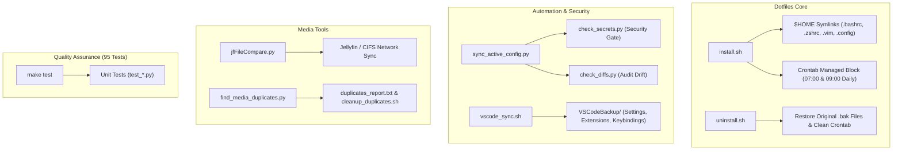

# Dotfiles Repository Wiki

Welcome to the **Dotfiles & Systems Automation Wiki**. This repository manages cross-platform shell configurations, editor settings, developer tooling, automated sync pipelines, secret leak prevention guards, and media library synchronization.

---

## Current Status Dashboard

| Component / System | Status | Key Script / Entry Point | Description |
| :--- | :---: | :--- | :--- |
| **Dotfiles Core** |  | [`install.sh`](file:///home/mike/work/dotfiles/install.sh) | Symlinks configurations with automatic `.bak` backups |
| **Automated Testing** |  | `make test` / `python3 -m unittest` | Full unittest discovery across 7 test modules |
| **Secret & SSH Guard** |  | [`check_secrets.py`](file:///home/mike/work/dotfiles/check_secrets.py) | Scans for API tokens, private SSH keys, and secrets |
| **Configuration Audit** |  | [`check_diffs.py`](file:///home/mike/work/dotfiles/check_diffs.py) | Unified diff audit between `$HOME` and repository |
| **Daily Config Sync** |  | [`sync_active_config.py`](file:///home/mike/work/dotfiles/sync_active_config.py) | Daily automated branch sync with secret safeguards |
| **VS Code Sync** |  | [`vscode_sync.sh`](file:///home/mike/work/dotfiles/vscode_sync.sh) | Settings, keybindings, snippets, and extension backups |
| **Jellyfin File Compare** |  | [`jfFileCompare.py`](file:///home/mike/work/dotfiles/jfFileCompare.py) | Fast multi-threaded CIFS/local media synchronization |
| **Media Duplicate Scanner** |  | [`find_media_duplicates.py`](file:///home/mike/work/dotfiles/find_media_duplicates.py) | Safe, non-destructive duplicate media scanner & cleaner |

---

## Repository Architecture



---

## Active Crontab Configuration

The following automated jobs are scheduled in the user crontab:
```cron
# Daily VS Code settings and extension backup at 7:00 AM
0 7 * * * /bin/bash /home/mike/work/dotfiles/vscode_sync.sh backup >> /home/mike/work/dotfiles/vscode_backup.log 2>&1

# Daily active dotfiles pull, diff, secret scan, and branch sync at 9:00 AM
0 9 * * * /home/mike/work/dotfiles/sync_active_config.sh >> /home/mike/work/dotfiles/sync_cron.log 2>&1
```

---

## Wiki Pages Directory

- **[Installation and Setup](Installation-and-Setup)**: Step-by-step installation, restoration, Vim pathogen bootstrap, Oh My Zsh plugins, and crontab scheduling.
- **[Security and Audit Tools](Security-and-Audit-Tools)**: Complete guide on `check_secrets.py` pattern matching, entropy, ignore rules, and `check_diffs.py`.
- **[Configuration Sync](Configuration-Sync)**: Machine-and-date branch synchronization workflow, clean Git stash handling, and safety guards.
- **[VS Code Sync](VS-Code-Sync)**: Backing up and restoring VS Code configurations, keybindings, snippets, and marketplace extensions.
- **[Media Management Tools](Media-Management-Tools)**: Complete documentation for `jfFileCompare.py` (Jellyfin sync) and `find_media_duplicates.py` (safe multi-stage duplicate scanner).
- **[Testing and Quality Assurance](Testing-and-Quality-Assurance)**: Test structure, executing suites, fixture mock environments, and verification standards.
